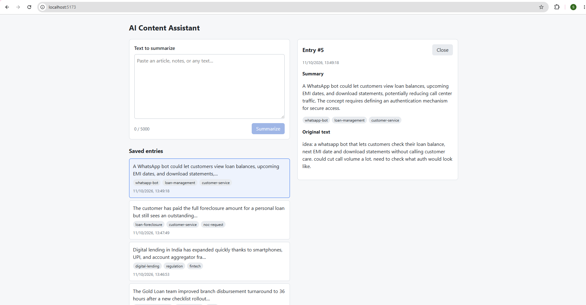
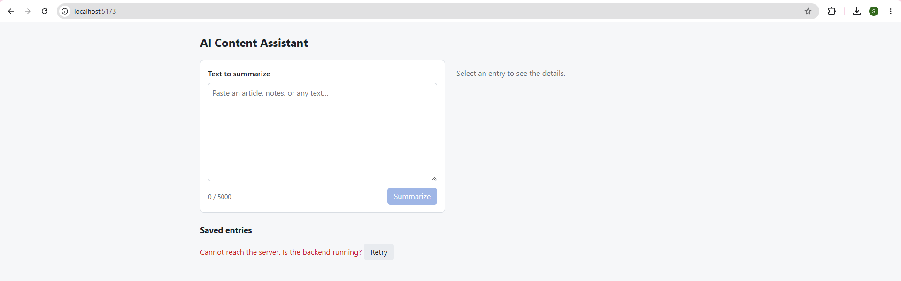

# AI Content Assistant

A small full-stack prototype: paste a block of text (notes, an article draft, a meeting transcript) and an LLM returns a concise summary and exactly three tags. Every result is saved and can be reopened later.

**Stack:** React (Vite) · FastAPI · SQLite · Groq (`openai/gpt-oss-20b`) · pytest



## Setup

**Prerequisites:** Python 3.10+, Node.js 20.19+ or 22.12+, and a Groq API key (free at [console.groq.com](https://console.groq.com)).

**1. Configure** (from the repo root):

```powershell
Copy-Item .env.example .env      # macOS/Linux: cp .env.example .env
# then set GROQ_API_KEY in .env
```

**2. Backend** (terminal 1, runs on http://localhost:8000):

```powershell
cd backend
python -m venv .venv
.\.venv\Scripts\Activate.ps1     # macOS/Linux: source .venv/bin/activate
pip install -r requirements.txt
uvicorn app.main:app --reload --port 8000
```

The SQLite database (`backend/data.db`) and its table are created automatically on first start. Interactive API docs: http://localhost:8000/docs

**3. Frontend** (terminal 2, runs on http://localhost:5173):

```powershell
cd frontend
npm install
npm run dev
```

**4. Tests** (from `backend`, venv active):

```powershell
pip install -r requirements-dev.txt
pytest -v
```

The tests never call the real LLM (it is monkeypatched) and use a temporary database, so they run offline and don't need an API key.

## API

| Method | Path | Description |
|---|---|---|
| POST | `/entries` | `{"text": "..."}` → generate summary + tags, save, return entry (201) |
| GET | `/entries` | List saved entries, newest first |
| GET | `/entries/{id}` | Full entry (404 if missing) |

Errors: `422` for empty or over-5000-character input, `502` with a readable message when the AI call fails, `500` if the API key is not configured.

## Project structure

```
backend/app/    main.py (routes) · schemas.py · db.py · llm.py (only file that calls the LLM) · parser.py (pure validation)
backend/tests/  test_parser.py · test_api.py
frontend/src/   api.js · App.jsx · components/ (EntryForm, EntryList, EntryDetail)
```

## Questions

### 1. Architecture
The React form sends `POST /entries` to FastAPI, where Pydantic rejects empty or over-long input (422). `llm.py` wraps the text in `<text>` delimiters and calls Groq in JSON mode. `parser.py` strips code fences, parses the JSON, requires a non-empty summary and exactly three tags, and normalizes tags to ASCII kebab-case. Only a valid result is written to SQLite (text, summary, tags as JSON, UTC timestamp) and returned with 201. The frontend adds it to the list and opens the detail view, which loads `GET /entries/{id}`; the list comes from `GET /entries`.

### 2. AI choice
Groq with `openai/gpt-oss-20b`, run with `reasoning_effort="low"`. Summarizing and tagging short text doesn't need a large model, and Groq's inference is very fast with a free tier, which suits a prototype. JSON mode guarantees parseable output. The provider call lives in one file and the model name comes from `.env`, so switching models or providers is a small, isolated change. I did this twice during the build: from Anthropic to Groq, and again when Groq retired `llama-3.3-70b-versatile`.

### 3. Reliability
Each LLM call has a 30s HTTP timeout, with the SDK's own retries disabled. If the output is malformed (bad JSON, missing summary, wrong or duplicate tags), the backend retries once, so the worst case is two calls. On a second failure, a timeout, bad key, rate limit, or retired model, it returns a 502 with a specific message and saves nothing; the real error is logged server-side without the key or user text. The frontend shows the message, keeps the user's text, and offers Retry if the entry list fails to load. Known gap: the model once returned a refusal in valid JSON; the prompt now asks it to describe instructions neutrally, but production would need an output check.



### 4. Privacy
The full submitted text and the system prompt are sent to Groq; no user identifiers or metadata. No redaction is implemented, so any names or account numbers pasted into the text are sent as-is. In financial services I would mask PII (names, PAN, Aadhaar, account/loan numbers, phone numbers) before the call, use a paid tier with a data-processing agreement (no training, limited retention), and check data-residency rules. Delimiters and stripping `</text>` reduce prompt-injection risk but don't eliminate it.

### 5. Production next step
- **Data protection:** PII redaction before the LLM call, authentication, and an enterprise LLM agreement.
- **Resilience:** a fallback provider behind the existing `llm.py` interface, async processing for long inputs, and per-user rate limits.
- **Quality and operations:** a small evaluation set to tune and regression-test the prompt (summary length, refusals), latency/cost/error metrics, and Postgres with migrations.

### 6. AI coding tools
I used Claude (chat) for planning and design review, and Claude Code in VS Code to implement from small, scoped prompts. I reviewed every diff and validated with stubbed smoke tests, the pytest suite, and manual browser checks before each commit. Real testing caught what generated code missed: a retired Groq model, a Unicode hyphen in tags, over-long summaries, and a refusal saved as a summary. A final AI-assisted review found an unclosed SQLite connection, a list error with no recovery path, duplicate tags being accepted, and overstated README claims; all were fixed and covered by tests where possible.

## Deliberately out of scope
Authentication, Docker/CI, cloud deployment, and monitoring were left out to respect the timebox; see "Production next step" above.
